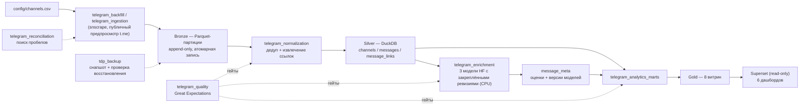
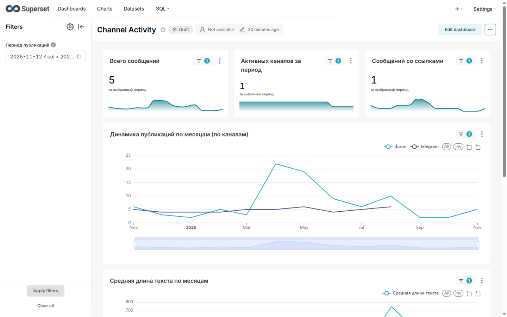
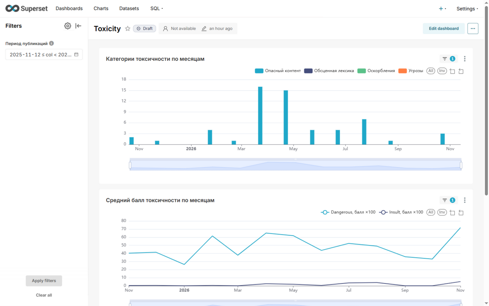
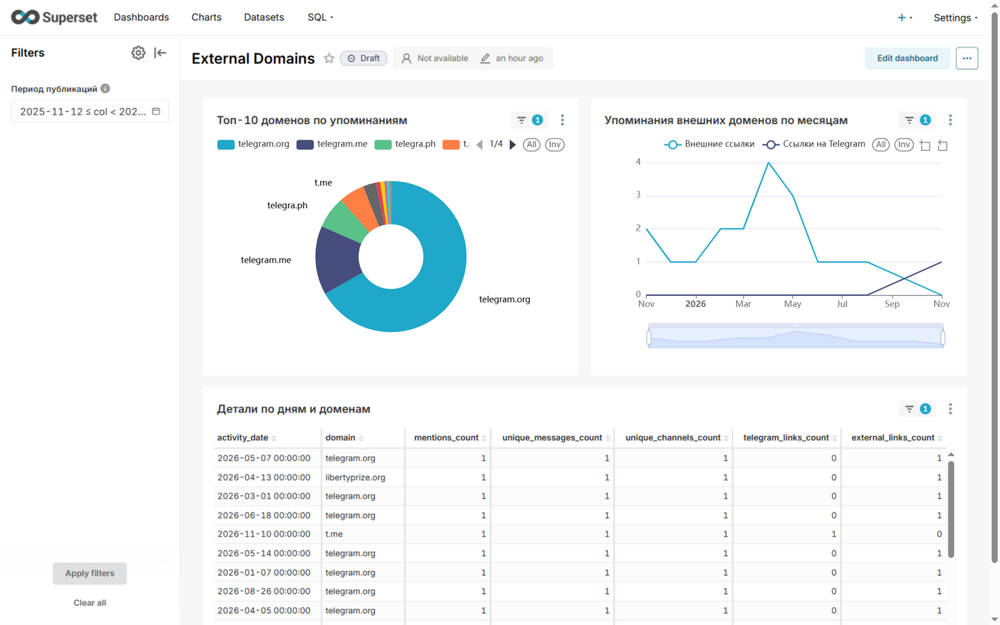

# Telegram Data Platform

[](https://www.python.org/)
[](https://airflow.apache.org/)
[](https://duckdb.org/)
[](.github/workflows/tests.yml)
[](LICENSE)

## О проекте

**Telegram Data Platform** — сквозная аналитическая платформа (end-to-end data
platform), которая автоматически собирает публикации из Telegram-каналов,
обрабатывает и нормализует их, обогащает результатами ML-моделей и
предоставляет готовую аналитику в виде интерактивных дашбордов.

Полный конвейер: **сбор (snscrape) → сырое хранилище Bronze (Parquet) →
нормализованный слой Silver (DuckDB) → ML-обогащение (Hugging Face) →
аналитические витрины Gold → дашборды Apache Superset**. Оркестрация —
**Apache Airflow**, контроль качества — **Great Expectations**, запуск —
**Docker Compose** одной командой.

Проект разработан в рамках **диссертационного исследования** и демонстрирует
полный цикл инженерии данных на реальном источнике: от проектирования
спецификации и слоёв хранения до ML-обогащения, контроля качества данных и
визуализации. Полное техническое задание с пофазной реализацией и критериями
готовности — в [openspec.md](openspec.md).

## Что можно делать с платформой

- **Мониторить активность каналов** — сколько и когда публикуют каналы,
  как меняется интенсивность по месяцам, доля постов с текстом и ссылками.
- **Отслеживать тональность контента** — доля негативных/нейтральных/позитивных
  публикаций по каналам и периодам (модель тональности).
- **Оценивать токсичность** — категории оскорблений, обсценной лексики, угроз
  и опасного контента по месяцам, со средними баллами моделей.
- **Анализировать эмоциональный фон** — радость, грусть, удивление, страх,
  злость в публикациях каналов.
- **Видеть внешнюю активность** — топ упоминаемых доменов, динамика внешних
  ссылок и ссылок на другие Telegram-каналы (задел для графового анализа).
- **Контролировать сам конвейер** — здоровье DAG-ов, успешность запусков,
  результаты проверок качества данных на отдельном дашборде.

Типовые сценарии: исследование медиа-активности, сравнение каналов,
выявление резонансных публикаций, мониторинг информационного фона,
учебные и исследовательские задачи по анализу данных.

## Как это работает



### Слои данных (медальон Bronze → Silver → Gold)

| Слой | Где | Что содержит | Правила |
|---|---|---|---|
| **Bronze** | Parquet, `data/bronze/` | сырые результаты сбора, без изменений | append-only, атомарная запись через временный файл + rename; повторный сбор допустим |
| **Silver** | DuckDB, таблицы | `channels`, `messages`, `message_links`, `message_meta` | дедупликация при загрузке; по одному сообщению — одна актуальная запись; устойчивые ключи `sha256(source, channel, message_id)` |
| **Gold** | DuckDB, витрины | 8 аналитических витрин по дням/каналам/доменам | пересчитываются целиком из Silver, без обращения к Telegram |

### Конвейер по шагам

1. **Сбор.** Реестр каналов (`config/channels.csv`) → DAG-и `telegram_backfill`
   (первичная история) и `telegram_ingestion` (ежечасный инкремент с
   перекрытием). Сбор идёт через публичный веб-предпросмотр `t.me/s/<канал>`
   (snscrape): без API-ключей и аккаунта. Каждый канал — независимая
   mapped-задача: ошибка одного не останавливает остальные, состояние сбора
   хранится по каналам и продвигается только после успешной записи в Bronze.
2. **Нормализация.** DAG `telegram_normalization` читает новые Bronze-файлы,
   дедуплицирует (побеждает последняя версия сообщения, самая ранняя дата
   первого сбора сохраняется), извлекает и классифицирует ссылки
   (telegram / invite / external), публикует Silver в DuckDB.
3. **ML-обогащение.** DAG `telegram_enrichment` прогоняет три локальные
   модели Hugging Face (`rubert-tiny-toxicity`, `rubert-tiny-sentiment-balanced`,
   `rubert-tiny2-cedr-emotion-detection`), закреплённые на точных commit SHA.
  sigmoid-головки по карточкам моделей (не softmax), все оценки классов
   сохраняются в `scores_json`, версии моделей и `input_hash` гарантируют
   пересчёт при изменении текста.
4. **Качество.** DAG `telegram_quality` гоняет наборы Great Expectations по
   Bronze/Silver/Gold: уникальность ключей, ссылочная целостность,
   неотрицательность счётчиков, допустимые значения, диапазон оценок [0, 1].
   Уровни PASS / WARN / FAIL — критические проверки блокируют публикацию.
5. **Витрины.** DAG `telegram_analytics_marts` пересобирает 8 витрин Gold
   (активность, тональность, токсичность, эмоции, контент, домены, рёбра
   каналов, здоровье пайплайна) и выполняет gold-проверки гранулярности.
6. **BI.** Superset подключён к DuckDB строго в режиме `access_mode=read_only`
   (сосуществует с единственным писателем) и показывает 6 дашбордов.
7. **Надёжность.** Ежедневный DAG `tdp_backup` делает согласованный снапшот
   DuckDB + дамп метаданных Superset и автоматически проверяет восстановление;
   `telegram_reconciliation` пересобирает недавние окна истории и находит
   пробелы.

### Ключевые инженерные решения

- **Идемпотентность по построению.** Детерминированные ключи, append-only
  Bronze, upsert-публикация в одиночных транзакциях — повторный запуск любого
  DAG-а не дублирует и не теряет данные.
- **Один писатель DuckDB.** Все записи идут через одного контролируемого
  издателя; Superset подключён read-only и сосуществует с писателем.
- **Воспроизводимый ML.** Ревизии моделей зафиксированы (запрещено
  автообновление), результаты несут версии модели/inference и `input_hash`.
- **Окружение через uv.** `uv.lock` — единый источник истины для локальной
  разработки и Docker-образа; torch ставится CPU-only (без ~1.5 ГБ CUDA-стека).

## Быстрый старт

Нужно: Docker + Docker Compose v2 ([uv](https://docs.astral.sh/uv/) — только
для локальных тестов).

```bash
cp .env.example .env          # заполнить POSTGRES_PASSWORD, AIRFLOW_ADMIN_PASSWORD,
                              # SUPERSET_ADMIN_PASSWORD (+ опциональные секретные ключи)
docker compose build
docker compose up airflow-init
docker compose up -d
```

Далее в **Airflow** (http://localhost:8080, логин из `.env`) разлочить и
запустить `telegram_backfill` — начнётся первичная загрузка истории каналов;
часовые DAG-и подхватят инкремент сами. В **Superset** (http://localhost:8088)
6 дашбордов создаются автоматически и читают витрины Gold.

Добавление каналов — дописать в `config/channels.csv` (`username,is_active`)
и перезапустить `telegram_backfill`.

## Дашборды

| Дашборд | Что показывает |
|---|---|
| **Channel Activity** | KPI (сообщений, активных каналов, со ссылками — за период), динамика публикаций по месяцам по каналам, средняя длина текста, детальная таблица |
| **Sentiment** | доли негатива/нейтрала/позитива по месяцам, количество сообщений по тональности, детали |
| **Toxicity** | категории токсичности по месяцам, средний балл, детали |
| **Emotions** | 5 эмоций по месяцам, детали |
| **External Domains** | топ-10 доменов (донат), динамика внешних ссылок, детали |
| **Pipeline Health** | успешность DAG-ов, fail-запуски, проверки качества |

На каждом дашборде — **фильтр периода** («Период публикаций»): по умолчанию
выбран последний год, можно задать произвольный диапазон дат — применяется
ко всем графикам.

### Скриншоты

**Channel Activity** — KPI за период, динамика публикаций по каналам:



**Toxicity** — категории токсичности по месяцам, средний балл:



**External Domains** — топ-10 доменов, динамика внешних ссылок:



## Тесты

```bash
uv sync                # полное окружение, включая torch (CPU-колёса на Windows/macOS)
uv run pytest          # 45 быстрых тестов: ключи, идемпотентность публикации,
                       # извлечение ссылок, гранулярность витрин, гейты качества
uv run pytest -m slow  # smoke-тесты моделей — при первом запуске скачивают ревизии
```

## Структура проекта

```
config/    реестр каналов (CSV)
dags/      8 DAG-ов Airflow (тонкие; тяжёлая логика — в src/)
src/
  warehouse/      DDL, детерминированные ключи, идемпотентный издатель
  ingestion/      snscrape-коллектор, запись Bronze, состояние сбора
  normalization/  преобразования Bronze→Silver, извлечение/классификация URL
  enrichment/     реестр моделей, адаптеры inference, построение message_meta
  quality/        рантайм GX, наборы Bronze/Silver, gold-проверки
  marts/          SQL-определения 8 витрин Gold, pipeline health
docker/superset/   образ, конфиг, bootstrap (подключение, датасеты, дашборды)
scripts/           инициализация склада, бэкап/восстановление, хелперы Superset
tests/             45 unit/integration тестов + smoke-тесты моделей
data/              рантайм-данные (в .gitignore)
```

## Документация

- [openspec.md](openspec.md) — полное техническое задание: требования по фазам
  (инфраструктура → модель данных → сбор → нормализация → ML → качество →
  аналитика → BI), спецификации таблиц и витрин, Definition of Done.
- [OPERATIONS.md](OPERATIONS.md) — эксплуатационный runbook: старт из чистого
  окружения, расписания DAG-ов, алерты, резервное копирование и восстановление,
  типовые операции.

## Ограничения

- Источник — публичный веб-предпросмотр Telegram (`t.me/s/<name>`): без
  API-ключей, но счётчики просмотров/пересылок недоступны (хранятся как NULL,
  не выдумываются), глубина истории ограничена веб-интерфейсом.
- DuckDB — одноузловое хранилище с одним писателем (выбор зафиксирован в
  спецификации); замена на клиент-серверное хранилище затронет только
  `src/warehouse`.
- `content_hash` находит одинаковое содержимое, но не используется как
  первичный ключ: повторяющиеся одинаковые посты остаются отдельными
  сообщениями.

## Лицензия

[MIT](LICENSE)
