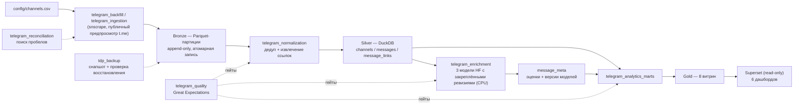

# Telegram Data Platform

[](https://www.python.org/)
[](https://airflow.apache.org/)
[](https://duckdb.org/)
[](.github/workflows/tests.yml)
[](LICENSE)

Сквозная пакетная data-платформа для сбора, обработки и аналитики контента
Telegram-каналов:

**snscrape → Bronze (Parquet) → Silver (DuckDB) → ML-обогащение (Hugging Face)
→ витрины Gold → Apache Superset** — полная оркестрация **Apache Airflow**,
гейты качества **Great Expectations** между слоями и бэкапы с проверкой
восстановления.

> Проект построен по спецификации: полное ТЗ живёт в
> [openspec.md](openspec.md) (8 фаз, Definition of Done). Каждая фаза
> реализована и проверена на соответствие — эксплуатационный runbook в
> [OPERATIONS.md](OPERATIONS.md).

## Архитектура



## Ключевые решения

- **Идемпотентность везде.** Детерминированные ключи (`sha256(source,
  channel_id, message_id)`), append-only Bronze с атомарными переименованиями,
  upsert-публикация в одиночных транзакциях — повторный запуск любого DAG-а
  не дублирует и не теряет данные.
- **Один писатель.** DuckDB используется как встроенное аналитическое
  хранилище; все записи идут через одного контролируемого издателя на DAG,
  DataFrame не передаются через XCom, а Superset подключён строго в
  `access_mode=read_only` (сосуществует с писателем).
- **Воспроизводимый ML.** Три модели `rubert-tiny` закреплены на точных
  commit SHA Hugging Face, sigmoid-головки по карточкам моделей (не softmax),
  версионируемые пороги, инвалидация по `input_hash` — правка текста
  перезапускает обогащение, результаты несут полный провенанс модели.
- **Гейты качества.** Наборы Great Expectations для Bronze/Silver/Gold с
  уровнями PASS/WARN/FAIL; критические сбои роняют задачу Airflow и
  блокируют downstream; полная история — в `quality_results`.
- **Проверяемые бэкапы.** Ежедневный согласованный снапшот DuckDB
  (ATTACH read-only, не сырая копия файла) + pg_dump метаданных Superset,
  с проверкой восстановления внутри самого бэкапа.
- **Воспроизводимое окружение.** Зависимости Python управляются **uv**
  (`uv.lock` — единый источник истины, тот же лок собирает Docker-образ),
  torch ставится CPU-only (без ~1.5 ГБ неиспользуемого CUDA-стека).

## DAG-и Airflow

| DAG | Расписание | Назначение |
|---|---|---|
| `telegram_backfill` | вручную | Первичная загрузка истории каналов из реестра |
| `telegram_ingestion` | ежечасно | Инкрементальный сбор с перекрытием и курсорами по каналам |
| `telegram_normalization` | ежечасно | Bronze → Silver: дедуп, извлечение и классификация URL |
| `telegram_enrichment` | ежечасно | Inference toxicity/sentiment/emotion, запись `message_meta` |
| `telegram_analytics_marts` | ежечасно | Пересборка 8 витрин Gold + gold-проверки |
| `telegram_quality` | ежечасно | GX-проверки Bronze/Silver (PASS/WARN/FAIL, история) |
| `telegram_reconciliation` | ежедневно 04:00 | Пересбор свежего окна, поиск пробелов |
| `tdp_backup` | ежедневно | Снапшот склада + дамп метаданных Superset, проверка восстановления |

Ошибки каналов изолированы на уровне mapped-задач: недоступный канал
фиксируется в `collection_state` и не останавливает остальные.

## Быстрый старт

Нужно: Docker + Docker Compose v2 ([uv](https://docs.astral.sh/uv/) — только
для локальных тестов).

```bash
cp .env.example .env          # заполнить POSTGRES_PASSWORD, AIRFLOW_ADMIN_PASSWORD,
                              # SUPERSET_ADMIN_PASSWORD (+ опциональные секретные ключи)
docker compose build
docker compose up airflow-init
docker compose up -d
```

- **Airflow UI:** http://localhost:8080 — разлочить `telegram_backfill` и
  запустить; часовые DAG-и подхватят работу сами.
- **Superset:** http://localhost:8088 — шесть дашбордов создаются
  автоматически при первом старте, все читают витрины Gold.

Добавление каналов — дописать в `config/channels.csv`
(`username,is_active`) и запустить `telegram_backfill`.

## Тесты

```bash
uv sync                # полное окружение, включая torch (CPU-колёса на Windows/macOS)
uv run pytest          # 45 быстрых тестов: ключи, идемпотентность публикации,
                       # извлечение ссылок, гранулярность витрин, гейты качества
uv run pytest -m slow  # smoke-тесты моделей — при первом запуске скачивают ревизии
```

## Структура проекта

```
config/    реестр каналов (CSV)
dags/      8 DAG-ов Airflow (тонкие; тяжёлая логика — в src/)
src/
  warehouse/      DDL, детерминированные ключи, идемпотентный издатель
  ingestion/      snscrape-коллектор, запись Bronze, состояние сбора
  normalization/  преобразования Bronze→Silver, извлечение/классификация URL
  enrichment/     реестр моделей, адаптеры inference, построение message_meta
  quality/        рантайм GX, наборы Bronze/Silver, gold-проверки
  marts/          SQL-определения 8 витрин Gold, pipeline health
docker/superset/   образ, конфиг, bootstrap (подключение, датасеты, дашборды)
scripts/           инициализация склада, бэкап/восстановление, хелперы Superset
tests/             45 unit/integration тестов + smoke-тесты моделей
data/              рантайм-данные (в .gitignore): bronze/, staging/, warehouse/, logs/, backups/
```

## Особенности и ограничения

- Источник сбора — **публичный веб-предпросмотр** Telegram (`t.me/s/<name>`):
  без API-ключей, но счётчики просмотров/пересылок недоступны (хранятся как
  NULL, не выдумываются), а глубина истории ограничена веб-интерфейсом.
- DuckDB намеренно одноузловой и с одним писателем (зафиксировано в
  спецификации); архитектура изолирует все записи за издателем, поэтому
  замена на клиент-серверное хранилище затронет только `src/warehouse`.
- `content_hash` находит одинаковое содержимое, но никогда не используется
  как первичный ключ; повторяющиеся одинаковые посты остаются отдельными
  сообщениями.

## Лицензия

[MIT](LICENSE)
