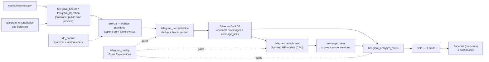

# Telegram Data Platform

[](https://www.python.org/)
[](https://airflow.apache.org/)
[](https://duckdb.org/)
[](.github/workflows/tests.yml)
[](LICENSE)

End-to-end batch data platform for collecting, modeling and serving Telegram
channel content:

**snscrape → Bronze (Parquet) → Silver (DuckDB) → ML enrichment (Hugging Face)
→ Gold marts → Apache Superset** — fully orchestrated by **Apache Airflow**,
with **Great Expectations** quality gates between layers and verified backups.

> Built spec-first: the complete requirement specification lives in
> [openspec.md](openspec.md) (8 phases, Definition of Done). Every phase was
> implemented and verified against it — see [OPERATIONS.md](OPERATIONS.md)
> for the runbook.

## Architecture



## Highlights

- **Idempotent everywhere.** Deterministic keys (`sha256(source, channel_id,
  message_id)`), append-only Bronze with atomic renames, upsert-style
  publication in single transactions — re-running any DAG never duplicates
  or loses data.
- **One writer.** DuckDB is used as an embedded analytical store; all writes
  go through one controlled publisher per DAG, staging DataFrames never
  travel through XCom, and Superset connects strictly in
  `access_mode=read_only` (coexists with the writer).
- **Reproducible ML.** Three `rubert-tiny` models pinned to exact Hugging
  Face commit SHAs, sigmoid heads per model card (not softmax), versioned
  thresholds, `input_hash` invalidation — a text edit triggers re-enrichment,
  results carry full model provenance.
- **Quality gates.** Great Expectations suites for Bronze/Silver/Gold with
  PASS/WARN/FAIL; critical failures fail the Airflow task and block
  downstream; full history lands in `quality_results`.
- **Verified backups.** Daily consistent DuckDB snapshot (ATTACH read-only,
  not a raw file copy) + pg_dump of Superset metadata, with restore
  verification built into the backup itself.
- **Reproducible environment.** Python deps managed by **uv** (`uv.lock` is
  the single source of truth — same lock builds the Docker image), torch
  installed CPU-only (no unused ~1.5 GB CUDA stack).

## Airflow DAGs

| DAG | Schedule | Purpose |
|---|---|---|
| `telegram_backfill` | manual | Initial history load for channels from the registry |
| `telegram_ingestion` | hourly | Incremental collection with overlap window and per-channel cursors |
| `telegram_normalization` | hourly | Bronze → Silver: dedup, URL extraction & classification |
| `telegram_enrichment` | hourly | Toxicity / sentiment / emotion inference, `message_meta` |
| `telegram_analytics_marts` | hourly | Rebuild 8 Gold marts + gold-level quality gates |
| `telegram_quality` | hourly | GX checks over Bronze/Silver (PASS/WARN/FAIL, history) |
| `telegram_reconciliation` | daily 04:00 | Re-collect recent window, detect gaps |
| `tdp_backup` | daily | Warehouse snapshot + Superset metadata dump, restore check |

Channel errors are isolated per mapped task: one unavailable channel is
recorded in `collection_state` and never stops the rest.

## Quick start

Prerequisites: Docker + Docker Compose v2 (and [uv](https://docs.astral.sh/uv/)
only for local tests).

```bash
cp .env.example .env          # fill POSTGRES_PASSWORD, AIRFLOW_ADMIN_PASSWORD,
                              # SUPERSET_ADMIN_PASSWORD (+ optional secret keys)
docker compose build
docker compose up airflow-init
docker compose up -d
```

- **Airflow UI:** http://localhost:8080 — unpause `telegram_backfill`, run it
  once; hourly DAGs pick up from there.
- **Superset:** http://localhost:8088 — six dashboards are provisioned
  automatically on first start, all reading Gold marts.

Add channels by editing `config/channels.csv` (`username,is_active`) and
running `telegram_backfill`.

## Testing

```bash
uv sync                # full env incl. torch (CPU wheels on Windows/macOS)
uv run pytest          # 45 fast tests: keys, publication idempotency,
                       # link extraction, marts granularity, quality gates
uv run pytest -m slow  # model smoke tests — download pinned revisions on first run
```

## Project layout

```
config/    channel registry (CSV)
dags/      8 Airflow DAGs (thin; heavy logic lives in src/)
src/
  warehouse/      DDL, deterministic keys, idempotent publisher
  ingestion/      snscrape collector, Bronze writer, collection state
  normalization/  Bronze→Silver transforms, URL extraction/classification
  enrichment/     model registry, inference adapters, message_meta builder
  quality/        GX runner, Bronze/Silver suites, gold checks
  marts/          SQL definitions of 8 Gold marts, pipeline health
docker/superset/   image, config, bootstrap (connection, datasets, dashboards)
scripts/           warehouse init, backup/restore, Superset helpers
tests/             45 unit/integration tests + model smoke tests
data/              runtime data (gitignored): bronze/, staging/, warehouse/, logs/, backups/
```

## Design notes & limitations

- The collection source is Telegram's **public web preview** (`t.me/s/<name>`):
  no API keys needed, but view/forward counters are unavailable (stored as
  NULL, never fabricated) and history depth is limited by the web interface.
- DuckDB is intentionally single-node/single-writer (documented in the spec);
  the architecture isolates all writes behind the publisher, so swapping in a
  client-server warehouse later touches only `src/warehouse`.
- `content_hash` detects identical content but is never used as a primary
  key; repeated identical posts stay separate messages.

## License

[MIT](LICENSE)
